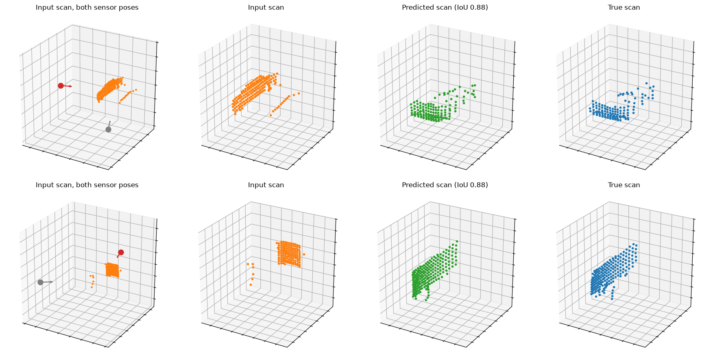

# LiDAR Flow Matching

A flow-matching model that takes a partial LiDAR scan of an object and a
relative sensor pose, and generates the scan the sensor will see after moving:

\[
(P_t,\;T_t^{-1}T_q)\longrightarrow P_q
\]

The object stays static. The relative sensor pose is the action.



Held-out test objects, a car (top) and a bus (bottom). The left panel shows the
input scan with the current sensor pose (red) and the queried pose (grey). Both
view pairs sit near the median test IoU for their category, not the best cases.

## Results

Test split: 518 held-out objects and 10,360 view pairs, 8 sampling steps. The
baseline copies the input scan unchanged. Ranges are in object radii.

| | Model | Copy input |
| --- | ---: | ---: |
| Occupancy IoU | 0.895 | 0.519 |
| Occupancy precision | 0.942 | 0.684 |
| Occupancy recall | 0.947 | 0.684 |
| Range RMSE, all true hits | 0.137 | 0.493 |
| Range RMSE, shared hits | 0.091 | 0.477 |

Occupancy IoU compares which of the `32 x 32` rays hit the object in the
predicted and true scans. Range RMSE is the error in return distance, either
over every ray the true scan hits or only over rays both scans hit.

The task is underdetermined. After moving, the sensor sees parts of the object
the input never covered, so many futures are plausible. Exact-match metrics
against a single ground truth therefore undersell a generative model. The real
test is visual inspection against the mesh, which `review.py` and `demo.py`
provide.

```bash
uv run python evaluate.py
```

This reproduces the table and writes per-pair counts to `artifacts/evaluation/`.

## Setup

Python 3.14 and [`uv`](https://docs.astral.sh/uv/) are required.

```bash
uv sync
uv run hf auth login
uv run wandb login
```

ShapeNetCore access is available from
[`ShapeNet/ShapeNetCore`](https://huggingface.co/datasets/ShapeNet/ShapeNetCore).

## Data

The dataset contains buses, cars, motorcycles and trains, normalized to a
bounding-sphere radius of 1. A `32 x 32` LiDAR gives 32 views per training
object and 20 per evaluation object. Splits are made by object before views are
generated.

```bash
uv run python prepare_data.py download 02924116 02958343 03790512 04468005
uv run python prepare_data.py generate vehicles 02924116 02958343 03790512 04468005
uv run python prepare_data.py inspect vehicles 02958343 <MODEL_ID> --view 0 --show
```

## Training

```bash
uv run python train.py --batch-size 8 --workers 0 --run view-flow-local
```

Hyperparameters are the defaults of `TrainingConfig` in `train.py` and
`ModelConfig` in `lidar_flow/model.py`. Training has a deliberately unreachable
step ceiling and stops from validation or the job time limit. On DTU HPC, set
`run` at the top of `train.lsf`, then:

```bash
mkdir -p runs
bsub < train.lsf
```

Architecture details are in [DESIGN.md](DESIGN.md).

## Review and demo

`evaluate.py`, `review.py` and `demo.py` load `runs/view-flow-a100-qknorm/best.pt`
by default. Pass another checkpoint path as the first argument.

```bash
uv run python review.py
```

`review.py` renders the mesh, input scan, true scan and generated scan in the
object frame, with IoU and range error. Cars are two thirds of the data, so use
`--synset` to reach the other categories.

```bash
uv run python demo.py
```

`demo.py` serves a local browser page that compares a prediction against a live
raycast of the mesh as you move the sensor. `--model-id` picks the object.
